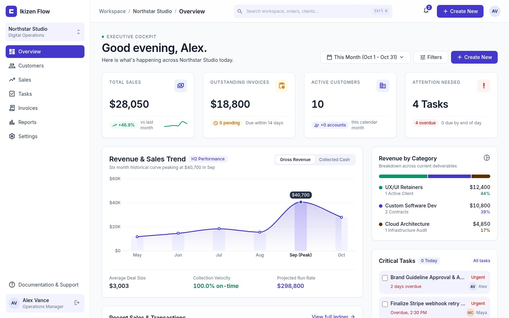
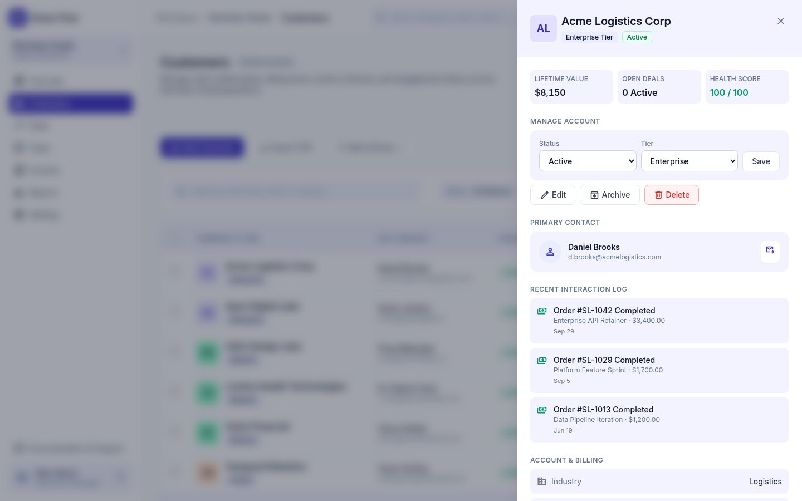
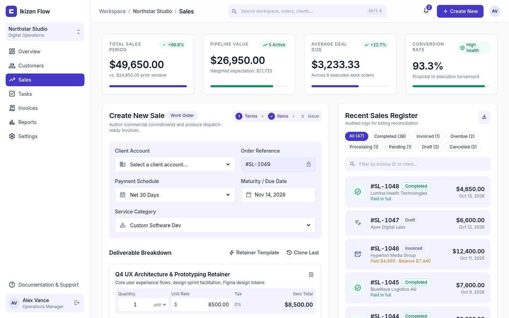
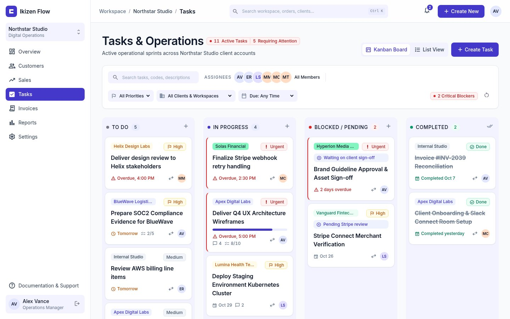
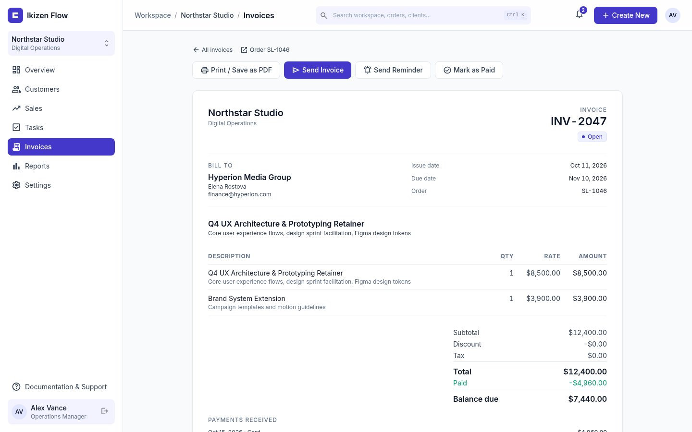
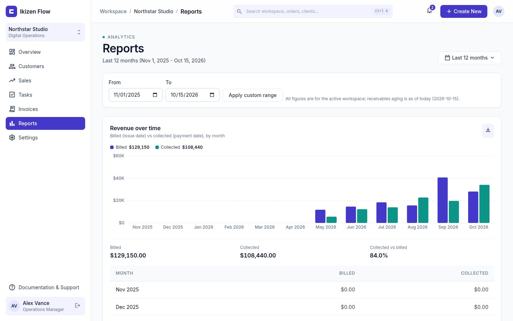
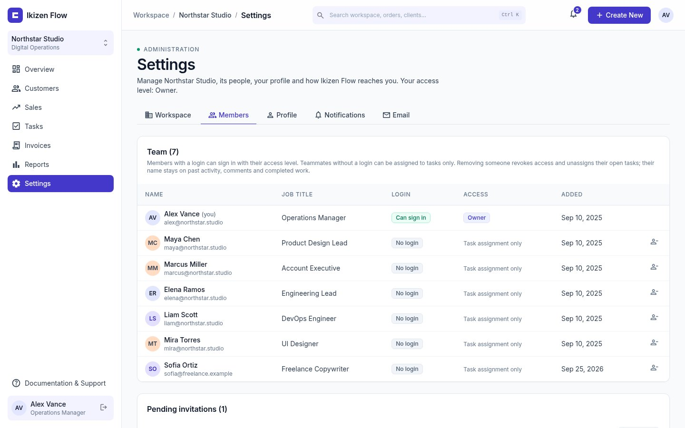
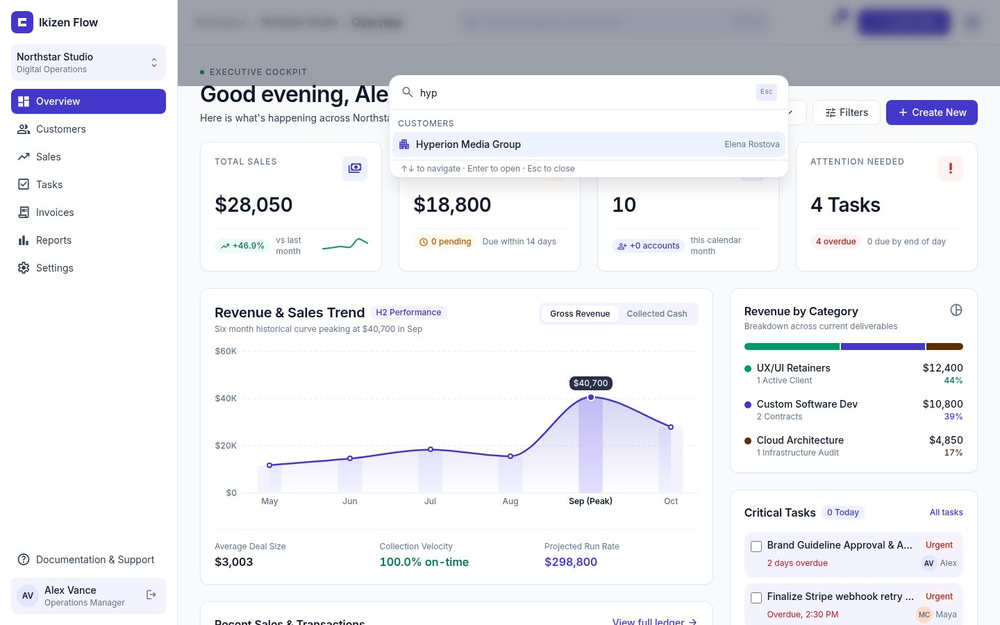
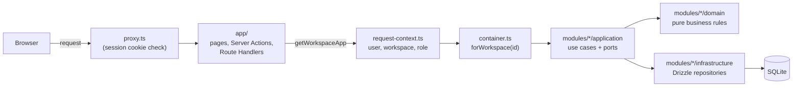

# Ikizen Flow

**The operations cockpit for service studios: customers, sales, invoices, tasks and reports in one multi-tenant workspace.**




Ikizen Flow is a fullstack Next.js app built by [Ikizen Agency](https://github.com/Ikizen-Agency) as a portfolio project. It runs the day-to-day of a digital studio: who the clients are, what was sold, what is still owed, and who is working on what. Every screen reads real data from a database, every action goes through a validated use case, and every record belongs to a workspace.

**Try it in 3 commands** (see [Getting started](#getting-started)):

```bash
pnpm install && pnpm db:reset && pnpm dev
```

Then sign in with the demo account:

| Email | Password |
| --- | --- |
| `alex@northstar.studio` | `ikizen-demo-123` |

---

## Contents

- [What it does](#what-it-does)
- [Tech stack](#tech-stack)
- [Architecture](#architecture)
- [Quality](#quality)
- [Getting started](#getting-started)
- [Deployment](#deployment)
- [Reference](#reference): environment, scripts, project structure, domain notes
- [Known limitations](#known-limitations)
- [Credits and license](#credits-and-license)

---

## What it does

| Module | Highlights |
| --- | --- |
| **Overview** `/` | KPIs, revenue trend chart, revenue by category, critical tasks, overdue receivables with one-click email reminders, filters, live refresh every 30 s |
| **Customers** `/customers` | Searchable directory, profile drawer, create / edit / archive / delete, tiers, bulk actions (email campaign, tag, archive), CSV export |
| **Sales** `/sales` | Order composer with line items and live totals, status lifecycle, partial payments with balances, auto-completion when fully paid, JSON / CSV API |
| **Tasks** `/tasks` | Kanban with drag and drop (plus an accessible "Move to" select), list view, checklists, `@mention` comments, attachments, time tracking |
| **Invoices** `/invoices` | Open / overdue / paid tabs, printable invoice page (Save as PDF), send invoice, reminders, record payment |
| **Reports** `/reports` | Date-range presets, billed vs collected revenue, top customers, pipeline, receivables aging, task throughput, time logged, CSV per section |
| **Settings** `/settings` | Workspace profile, members and roles (owner / admin / member), invitations, profile and password, notification preferences, email outbox |
| **Shell** | ⌘K / Ctrl+K command palette, notifications bell, workspace switcher, help center |

<table>
  <tr>
    <td><br /><sub>Customers: profile drawer with account management</sub></td>
    <td><br /><sub>Sales: order composer and sales register</sub></td>
  </tr>
  <tr>
    <td><br /><sub>Tasks: kanban board with filters</sub></td>
    <td><br /><sub>Invoices: printable invoice with payments and balance</sub></td>
  </tr>
  <tr>
    <td><br /><sub>Reports: revenue, pipeline, aging and throughput</sub></td>
    <td><br /><sub>Settings: members, access levels and invitations</sub></td>
  </tr>
  <tr>
    <td colspan="2"><br /><sub>⌘K command palette: workspace-scoped search across customers, orders and tasks</sub></td>
  </tr>
</table>

<details>
<summary>Full feature list per route</summary>

| Route | What you can do |
| --- | --- |
| `/` | KPIs, revenue trend, revenue by category, critical tasks, recent sales, team activity, overdue receivables. Filters (`?category=`, `?customer=`, `?assignee=`) with removable chips. Send Reminder emails the customer and shows the outbox status. Live Sync re-renders every 30 s while the tab is visible. |
| `/activity` | Team activity log with category, member and record-type filters and pagination. |
| `/customers` | Search, filters, pagination, detail drawer, create / edit, status and tier changes, archive / unarchive (`?status=archived`), delete (only without orders or tasks), row menu, bulk Send Campaign / Apply Tier Tag / Archive / Delete. `GET /customers/export` (CSV). |
| `/sales` | KPIs, status tabs, create orders with line items, status transitions, edit drafts and pending orders (`?edit=SL-xxxx`), delete unpaid drafts or cancelled orders, partial payments up to the balance. `GET /api/orders` (JSON / CSV with `paidCents` / `balanceCents`). |
| `/tasks` | Server-side search (`?q=`) with assignee, priority, client and due filters; drag and drop (moving to Blocked asks for a reason); create / edit / duplicate / delete; checklist; comments with `@` autocomplete and mention notifications; attachments; time tracking. |
| `/invoices` | KPI tiles, All / Open / Overdue / Paid tabs, search, filters, pagination; `/invoices/<number>` printable invoice with Send invoice, Send reminder, Mark as paid, Record payment. `GET /invoices/export` (CSV). |
| `/reports` | Presets (this month, last month, this quarter, year to date, last 12 months, custom). `GET /reports/export?section=…` (CSV per section). |
| `/settings` | Tabs: Workspace, Members, Profile, Notifications, Email (outbox with retry for failed deliveries). |
| `/invite/<token>` | Accept a workspace invitation. |
| `/help` | Getting started, keyboard shortcuts, module guides, FAQ, contact form (emails `SUPPORT_EMAIL`). |
| `/login`, `/register` | Email + password; registration creates a new workspace owned by the new user. |

</details>

---

## Tech stack

| Layer | Choice |
| --- | --- |
| Framework | Next.js 16 (App Router, Cache Components, Server Actions, Route Handlers), React 19 |
| Language | TypeScript (strict) |
| Styling | Tailwind CSS v4 with design tokens in `src/app/globals.css` |
| Data | SQLite through libSQL + Drizzle ORM, Zod validation |
| Auth | Better Auth (email + password, database sessions, Drizzle adapter) |
| Email | Nodemailer over SMTP, or an outbox-only log transport |
| Testing | Vitest (unit + integration on real SQLite), Playwright (end to end) |

---

## Architecture

Screaming architecture with a hexagonal-lite core: folders are named after business features, and each feature keeps its rules independent of the framework and the database.



| Concern | How it works |
| --- | --- |
| **Feature modules** | `src/modules/<feature>/` holds `domain/` (types and pure rules), `application/` (ports and use cases), `infrastructure/` (Drizzle adapters) and `ui/` (Server Actions and components). |
| **Composition root** | Only `src/server/container.ts` and `src/server/auth.ts` import the database client. `forWorkspace(id)` wires workspace-scoped repositories into use cases. |
| **Request context** | `src/server/request-context.ts` resolves `{ user, workspace, role, member }` once per request. Pages, actions and route handlers never pick a workspace themselves. |
| **Workspace tenancy** | Business tables carry `workspace_id`; every repository is constructed for one workspace, so another tenant's ids return nothing. The active workspace cookie is honoured only for workspaces the user belongs to. |
| **Auth** | Better Auth with database sessions. `src/proxy.ts` is only an optimistic redirect; the real check is the session lookup in the request context. Sign-up provisions a new workspace with the user as owner. |
| **Permissions** | Owner / admin / member rules live in use cases (`assertCan`), never only in the UI. The last owner can never be demoted or removed. |
| **Money and time** | Money is integer cents. "Overdue" is derived from due dates, never stored. |

---

## Quality

| Check | What it covers |
| --- | --- |
| **436 Vitest tests** (66 files) | Domain rules, use cases, schemas, and repositories against a real temporary SQLite database, including workspace isolation |
| **Playwright happy path** | Sign in, add a customer, create and confirm a sale, record a full payment, move a task, sign out, in a real browser against a production build |
| **Test-first** | Behaviour changes were written test-first: a failing test (RED) was observed before the implementation (GREEN) |
| **Independent security verification** | Features were checked by independent verification passes. Fixes they found include an open-redirect guard on post-login redirects, single-recipient email validation, path-safe attachment storage and transactional payment limits |
| **Static checks** | `pnpm typecheck` (strict TypeScript) and `pnpm lint` (ESLint) |

---

## Getting started

Requirements: Node.js 20+ and pnpm.

```bash
pnpm install
pnpm db:reset    # migrate + seed demo data into data/ikizen.db
pnpm dev         # http://localhost:3000
```

Sign in as `alex@northstar.studio` / `ikizen-demo-123`. Alex owns two workspaces: **Northstar Studio** (full demo dataset) and **Helix Labs Sandbox** (small dataset). Switch from the workspace card at the top of the sidebar.

> [!TIP]
> The seed uses dates relative to today. Re-run `pnpm db:reset` to refresh due dates and trends.

No `.env` file is required for local development; see [Environment variables](#environment-variables) for production.

### End-to-end tests

```bash
pnpm exec playwright install chromium   # once
pnpm test:e2e
```

Playwright builds the app and serves it on port 3520 (`E2E_PORT` to change it) against an isolated database (`data/e2e.db`, uploads in `data/e2e-uploads`), so development data is never touched. If the bundled browser cannot be downloaded, use a system Chromium: `PLAYWRIGHT_CHROMIUM_PATH=/usr/bin/chromium pnpm test:e2e`.

`pnpm screenshots` uses the same isolated server to regenerate the images in `docs/screenshots/`.

---

## Deployment

The app is deployed to [Vercel](https://vercel.com) by GitHub Actions ([`.github/workflows/deploy-vercel.yml`](.github/workflows/deploy-vercel.yml)):

- **Push to `main`** → production deployment (`vercel --prod`). **Push to `staging`** → preview deployment.
- Every run first installs with the pinned pnpm (`packageManager`) on Node 22 and gates the deployment on `pnpm lint`, `pnpm typecheck`, `pnpm test` and `pnpm build`. Vercel then builds the app again remotely.
- The CLI passes `ENABLE_EXPERIMENTAL_COREPACK=1` as a build variable, so Vercel installs pnpm 11 from `packageManager` (and honours `allowBuilds` in `pnpm-workspace.yaml`), plus the runtime variables `BETTER_AUTH_SECRET` and `IKIZEN_DEMO_MODE=ephemeral`.
- Runs are serialized per branch, so deployments never overlap.

Required GitHub secrets:

| Secret | Scope | Purpose |
| --- | --- | --- |
| `VERCEL_TOKEN` | organization | Vercel access token used by the CLI |
| `BETTER_AUTH_SECRET` | repository | Session signing secret, at least 32 characters (`openssl rand -base64 32`) |

**Ephemeral demo data.** Vercel functions have no persistent disk, so the hosted demo runs in *ephemeral demo mode* (`IKIZEN_DEMO_MODE=ephemeral`, also on automatically when `VERCEL=1` and no `DATABASE_URL` is set). The SQLite database lives in `/tmp/ikizen.db` and attachments in `/tmp/ikizen-uploads`; the first query of each server instance applies the bundled `drizzle/` migrations and seeds the demo dataset. Everything visitors change is lost when the instance is recycled, and the login page shows the demo account with a "Demo data resets periodically" note. Better Auth uses `BETTER_AUTH_URL` when set, otherwise the production domain (`VERCEL_PROJECT_PRODUCTION_URL`) in production and the deployment URL in previews; deployment and branch URLs are trusted origins. Local development never enters this mode and keeps `pnpm db:reset`.

Live demo: _coming soon_

---

## Reference

### Environment variables

| Variable | Default | Notes |
| --- | --- | --- |
| `DATABASE_URL` | `file:./data/ikizen.db` (`file:/tmp/ikizen.db` in demo mode) | libSQL URL |
| `IKIZEN_DEMO_MODE` | unset | `ephemeral` enables the ephemeral demo mode (see [Deployment](#deployment)); also on when `VERCEL=1` without `DATABASE_URL` |
| `BETTER_AUTH_SECRET` | development-only value | **Required in production**: at least 32 characters (`openssl rand -base64 32`). The server refuses to start without it. |
| `BETTER_AUTH_URL` | `http://localhost:3000` (Vercel URL on Vercel) | Public origin of the app; also used for links in emails |
| `SMTP_HOST` | unset | When set, emails are delivered over SMTP. When unset, they are only recorded in the outbox as `logged`. |
| `SMTP_PORT` | `587` | SMTP port |
| `SMTP_SECURE` | `true` only on port 465 | Implicit TLS |
| `SMTP_USER` / `SMTP_PASS` | unset | SMTP credentials (optional) |
| `SMTP_FROM` | `Ikizen Flow <no-reply@ikizen.local>` | Sender address |
| `SUPPORT_EMAIL` | `support@ikizen.local` | Recipient of the Help page contact form |
| `UPLOADS_DIR` | `data/uploads` (`/tmp/ikizen-uploads` in demo mode) | Task attachment storage (absolute, or relative to the working directory) |

### Scripts

| Script | Description |
| --- | --- |
| `pnpm dev` / `build` / `start` | Next.js lifecycle |
| `pnpm typecheck` | `next typegen` + `tsc --noEmit` |
| `pnpm lint` | ESLint |
| `pnpm test` / `test:watch` | Vitest |
| `pnpm test:e2e` | Playwright end-to-end happy path |
| `pnpm screenshots` | Regenerate README screenshots |
| `pnpm db:generate` | Generate Drizzle migrations from the schema |
| `pnpm db:migrate` / `db:seed` / `db:reset` | Apply migrations, seed demo data, or both from scratch |

### Project structure

```
src/
  app/                  # thin routes: pages, layouts, route handlers
  proxy.ts              # optimistic auth redirect (Next 16 Proxy)
  modules/<feature>/    # auth, workspaces, customers, sales, invoices, reports, tasks,
    domain/             #   dashboard, activity, team, mail, notifications, search, help
    application/
    infrastructure/
    ui/
  server/
    auth.ts             # Better Auth instance
    container.ts        # composition root
    request-context.ts  # session -> user, workspace, role, member
    db/                 # schema, client, seed
  shared/
    ui/                 # design-system primitives
    shell/              # sidebar, topbar, mobile navigation
    domain/             # money and time helpers
drizzle/                # SQL migrations
e2e/                    # Playwright specs and screenshot capture
design/                 # Google Stitch design export (screens + DESIGN.md)
```

<details>
<summary>Domain notes (payments, invoices, attachments, team, email)</summary>

- **Payments**: balance = order total − sum of payments. Payments are accepted on open orders up to the balance; a fully paid order completes automatically. The balance check, insert and completion run in one transaction, so concurrent payments can never exceed the total. Orders with payments cannot be edited or deleted.
- **Invoices**: an invoice is an `invoiced` or `completed` order with an invoice number. Display status is derived: completed = Paid, invoiced past due = Overdue, otherwise Open. Money is never recomputed here; payments go through the sales use cases.
- **Reports**: URL presets resolve to a half-open UTC range (custom ranges capped at five years); pure functions aggregate workspace-scoped facts. Aging is always as of today.
- **Attachments**: 10 MB limit, extension allowlist, MIME type derived server-side, sanitized file names, random storage keys validated on every read so paths cannot escape `UPLOADS_DIR`. Downloads always use `Content-Disposition: attachment` and `nosniff`.
- **Comments and mentions**: mentions are stored as `@[Name](memberId)`; only newly mentioned members are notified, and only the author can edit or delete a comment.
- **Team**: removing a member revokes access, unassigns their open tasks and keeps their name on past work. Invitations last 7 days and only a SHA-256 hash of the token is stored.
- **Email outbox**: every email is stored (`queued`), delivered through SMTP or the log transport, and recorded as `sent`, `logged` or `failed`. Delivery failures never break the action that sent the email.
- **Notifications**: per member and type, in-app (default on) and email (default off).
- **Workspace deletion**: owners only, with typed name confirmation; never the user's last workspace.

</details>

---

## Known limitations

- Signing out from an invitation link with the wrong account returns to `/login` without keeping the invitation.
- Members cannot leave a workspace by themselves (an owner or admin removes them).
- No SQLite busy timeout: truly simultaneous writes can rarely fail with `SQLITE_BUSY`.
- The hosted demo is ephemeral: its SQLite database and attachments live in each Vercel instance's `/tmp`, so data resets when an instance is recycled, and concurrent instances do not share data (a session created on one instance is unknown to another). A persistent deployment needs a hosted libSQL database (`DATABASE_URL`) and an object-storage adapter for attachments.

---

## Credits and license

UI and UX are based on a [Google Stitch](https://stitch.withgoogle.com) design export, kept in [`design/`](design/) together with its design-token spec.

All rights reserved — Ikizen Agency.
